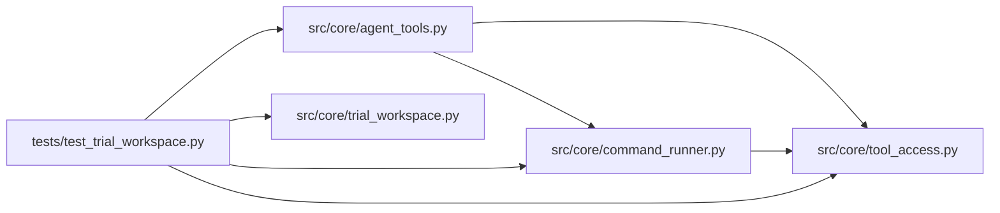

# test_trial_workspace Module

**Path:** `tests/test_trial_workspace.py`

## Description

Per-workdir trial state tests (P2 — ``execution.concurrency`` prerequisite).

Covers the :mod:`src.core.trial_workspace` module (context, allocation,
staging with the server-dir ignore list, fail-open staging, trial-first
marker candidates, eligibility predicate), the ``cwd`` seam through
``_tool_bash`` into the governed runner, and the ``--config`` snapshot
resolution against a trial base dir.

## Imports

| Source | Symbols |
|--------|---------|
| `__future__` | `annotations` |
| `os` | `os` |
| `pathlib` | `Path` |
| `src.core.agent_tools` | `_config_snapshot_path_from_command`, `_tool_bash` |
| `src.core.command_runner` | `CommandRunResult` |
| `src.core.tool_access` | `build_tool_access_context` |
| `src.core.trial_workspace` | `TRIALS_DIRNAME`, `TrialContext`, `allocate_trial_dir`, `build_trial_context`, `is_trial_eligible_command`, `stage_trial_or_none`, `stage_trial_workspace`, `trial_marker_candidates`, `tw` |
| `unittest.mock` | `MagicMock`, `patch` |

## Local dependency map

<!-- Auto-generated local dependency summary. Do not edit by hand. -->

### Internal neighbors

| Direction | Module |
|---|---|
| Outbound | [agent_tools](../modules/agent_tools.md) |
| Outbound | [command_runner](../modules/command_runner.md) |
| Outbound | [tool_access](../modules/tool_access.md) |
| Outbound | [trial_workspace](../modules/trial_workspace.md) |

## Classes

| Class | Line | Bases | Description |
|-------|------|-------|-------------|
| [_CapturingRunner](../entities/test_trial_workspace_CapturingRunner.md) | 183 | — | — |

## Functions

| Function | Signature | Decorators | Description |
|----------|-----------|------------|-------------|
| `test_eligible_when_command_invokes_sanctioned_script` | `()` | — | — |
| `test_ineligible_for_bookkeeping_or_empty_commands` | `()` | — | — |
| `test_allocate_trial_dir_creates_and_is_idempotent` | `(tmp_path)` | — | — |
| `test_trial_context_workdir_defaults_to_session_workspace` | `()` | — | — |
| `test_stage_trial_workspace_copies_state_and_ignores_server_dirs` | `(tmp_path)` | — | — |
| `test_stage_trial_or_none_fails_open` | `(monkeypatch, tmp_path)` | — | — |
| `test_trial_marker_candidates_trial_first` | `(tmp_path)` | — | — |
| `test_build_trial_context_default_concurrency_never_allocates` | `(tmp_path)` | — | — |
| `test_build_trial_context_eligible_command_allocates_and_stages` | `(tmp_path)` | — | — |
| `test_build_trial_context_bookkeeping_command_not_trialed` | `(tmp_path)` | — | — |
| `_ws_access` | `()` | — | — |
| `test_tool_bash_threads_cwd_to_governed_runner` | `()` | — | — |
| `test_config_snapshot_resolves_against_base_dir` | `(tmp_path)` | — | — |
| `test_config_snapshot_base_dir_outside_session_returns_none` | `(tmp_path)` | — | — |
