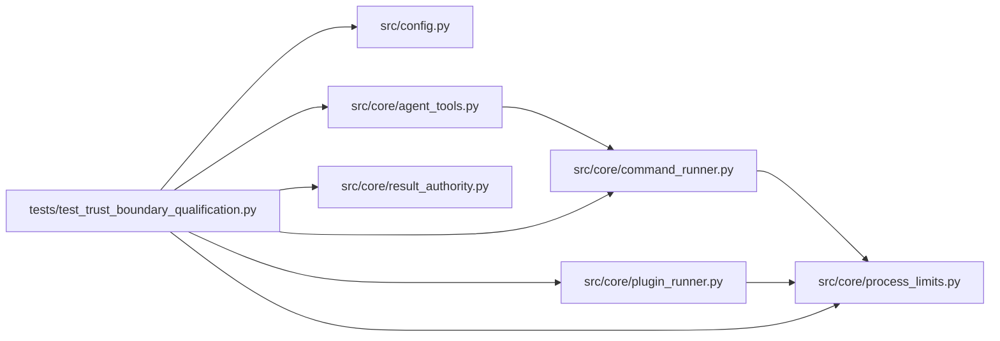

# test_trust_boundary_qualification Module

**Path:** `tests/test_trust_boundary_qualification.py`

## Description

Trusted-execution-boundary qualification lane.

Combined adversarial suite for the trust findings: candidate edits,
evaluator shadowing, symlink escapes, credential reachability, forged
results, and child-process escape attempts. Every attack runs against
disposable files, synthetic secrets, and isolated processes; enforcement is
asserted through filesystem sentinels and independent teardown inspection
rather than the tested API response, and negative controls demonstrate the
same fixture succeeding against the pre-boundary behavior so the lane cannot
pass on application-only checks. The live command templates run in fresh
isolated workspaces and the recorded result evidence is probed for
immutability after acceptance.

## Imports

| Source | Symbols |
|--------|---------|
| `__future__` | `annotations` |
| `asyncio` | `asyncio` |
| `hashlib` | `hashlib` |
| `json` | `json` |
| `os` | `os` |
| `pathlib` | `Path` |
| `psutil` | `psutil` |
| `pytest` | `pytest` |
| `src.config` | `get_settings` |
| `src.core.agent_tools` | `_execute_tool`, `build_tool_access_context` |
| `src.core.command_runner` | `GovernedCommandRunner`, `GovernedCommandRunner`, `GovernedCommandRunner` |
| `src.core.plugin_runner` | `PluginCaps`, `PluginRunner` |
| `src.core.process_limits` | `TERMINATION_BOUND_S` |
| `src.core.result_authority` | `issue_result_receipt`, `result_payload`, `verify_result_receipt`, `protected_result_names` |
| `subprocess` | `subprocess` |
| `sys` | `sys` |
| `time` | `time` |
| `yaml` | `yaml` |

## Local dependency map

<!-- Auto-generated local dependency summary. Do not edit by hand. -->

### Internal neighbors

| Direction | Module |
|---|---|
| Outbound | [config](../modules/config.md) |
| Outbound | [agent_tools](../modules/agent_tools.md) |
| Outbound | [command_runner](../modules/command_runner.md) |
| Outbound | [plugin_runner](../modules/plugin_runner.md) |
| Outbound | [process_limits](../modules/process_limits.md) |
| Outbound | [result_authority](../modules/result_authority.md) |

### External packages

| Language | Used packages | Undeclared packages |
|---|---:|---:|
| python | 3 | 2 |

## Functions

| Function | Signature | Decorators | Description |
|----------|-----------|------------|-------------|
| `_access` | `(shared_root: Path, session: Path, protected: dict \| None = None)` | — | — |
| `_pin_extension` | `(skill_id: str, rel: str, *, script_path: Path \| None = None) -> dict` | — | Digest-pin one packaged evaluator script (the immutable package path). |
| `_assert_no_survivors` | `(pids: list[int]) -> None` | — | — |
| `test_attack_candidate_edits_cannot_cross_sessions_or_protected_names` | `(tmp_path: Path) -> None` | — | — |
| `test_attack_workspace_evaluator_shadow_is_never_executed` | `(tmp_path: Path) -> None` | — | — |
| `test_attack_symlink_escapes_never_write_outside` | `(tmp_path: Path) -> None` | — | — |
| `test_attack_synthetic_secrets_reach_no_candidate_child` | `(tmp_path: Path, monkeypatch: pytest.MonkeyPatch) -> None` | — | — |
| `test_attack_forged_receipt_never_verifies` | `() -> None` | — | — |
| `test_attack_child_process_escape_denied_at_os` | `(tmp_path: Path) -> None` | — | — |
| `_live_template` | `(skill_id: str) -> str` | — | — |
| `_fresh_session` | `(tmp_path: Path, kind: str)` | — | — |
| `_bootstrap_into` | `(skill_id: str, session: Path, skill_params: dict) -> None` | — | — |
| `test_real_live_template_runs_and_evidence_is_immutable` | `(tmp_path: Path, skill_id: str, kind: str, skill_params: dict) -> None` | `@pytest.mark.parametrize('skill_id,kind,skill_params', [('db-config-tuning', 'autotuner', {'symbol': 'AAPL', 'timeframe': '1h', 'direction': 'long'}), ('code-refactor', 'refactor', {'symbol': 'AAPL', 'timeframe': '1h', 'direction': 'long', 'file_path': 'refactor_target.py'})])` | The declared live template runs in a fresh workspace; the recorded |
| `test_live_template_without_external_scorer_refuses_cleanly` | `(tmp_path: Path) -> None` | — | The live prompt-engineering template needs an external scorer; without |
