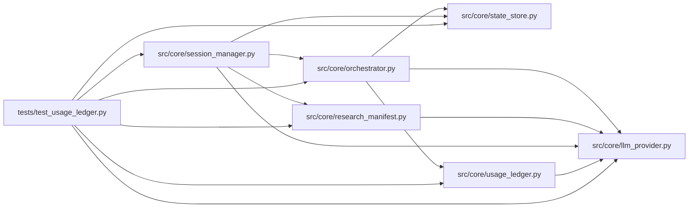

# test_usage_ledger Module

**Path:** `tests/test_usage_ledger.py`

## Description

Usage ledger: idempotent accounting with explicit cost knowledge.

Provider-specific calculations carry a versioned pricing basis; reported
usage, estimated money, billed money, and unavailable cost stay distinct;
unknown cost is never zero; retries and replays never double-charge; budget
reservations are atomic and never oversubscribe a strict known budget.

## Imports

| Source | Symbols |
|--------|---------|
| `__future__` | `annotations` |
| `asyncio` | `asyncio` |
| `json` | `json` |
| `pathlib` | `Path` |
| `pytest` | `pytest` |
| `src.core.llm_provider` | `COST_ESTIMATED`, `COST_UNAVAILABLE`, `AnthropicProvider`, `MockProvider`, `OpenAIProvider`, `Usage`, `_CLAUDE_INPUT_USD_PER_TOKEN`, `_CLAUDE_OUTPUT_USD_PER_TOKEN` |
| `src.core.orchestrator` | `ResearchConfig` |
| `src.core.research_manifest` | `_spend_enforcement` |
| `src.core.session_manager` | `session_manager_mod`, `SessionManager` |
| `src.core.state_store` | `BudgetExceeded`, `SQLiteStateStore` |
| `src.core.usage_ledger` | `ROLE_AGENT`, `ROLE_EVALUATOR`, `ROLE_INSIGHT`, `event_from_quote`, `mark_billed`, `record_usage_event`, `summarize_usage` |
| `subprocess` | `subprocess` |
| `sys` | `sys` |
| `textwrap` | `textwrap` |

## Local dependency map

<!-- Auto-generated local dependency summary. Do not edit by hand. -->

### Internal neighbors

| Direction | Module |
|---|---|
| Outbound | [llm_provider](../modules/llm_provider.md) |
| Outbound | [orchestrator](../modules/orchestrator.md) |
| Outbound | [research_manifest](../modules/research_manifest.md) |
| Outbound | [session_manager](../modules/session_manager.md) |
| Outbound | [state_store](../modules/state_store.md) |
| Outbound | [usage_ledger](../modules/usage_ledger.md) |

### External packages

| Language | Used packages | Undeclared packages |
|---|---:|---:|
| python | 1 | 1 |

## Functions

| Function | Signature | Decorators | Description |
|----------|-----------|------------|-------------|
| `_open_store` | *(async)* `(tmp_path: Path) -> SQLiteStateStore` | — | — |
| `_anthropic` | `() -> AnthropicProvider` | — | — |
| `_openai` | `() -> OpenAIProvider` | — | — |
| `test_provider_specific_calculations_with_versioned_basis` | `()` | — | — |
| `test_unknown_pricing_is_unavailable_never_zero` | `()` | — | — |
| `test_mock_zero_cost_is_a_real_zero` | `()` | — | — |
| `test_evaluator_and_insight_spend_is_counted` | `()` | — | — |
| `test_billed_money_is_distinct_from_estimates` | `()` | — | — |
| `test_retries_and_replays_do_not_double_charge` | *(async)* `(tmp_path)` | `@pytest.mark.asyncio` | — |
| `test_strict_budget_reservations_never_oversubscribe` | *(async)* `(tmp_path)` | `@pytest.mark.asyncio` | — |
| `test_advisory_limit_is_labeled_with_its_limits` | *(async)* `(tmp_path)` | `@pytest.mark.asyncio` | — |
| `test_manager_reserves_and_reconciles_budget` | *(async)* `(tmp_path, monkeypatch)` | `@pytest.mark.asyncio` | — |
| `test_parallel_budget_races_cannot_oversubscribe` | `(tmp_path)` | — | Real competing OS processes against one strict budget. |
