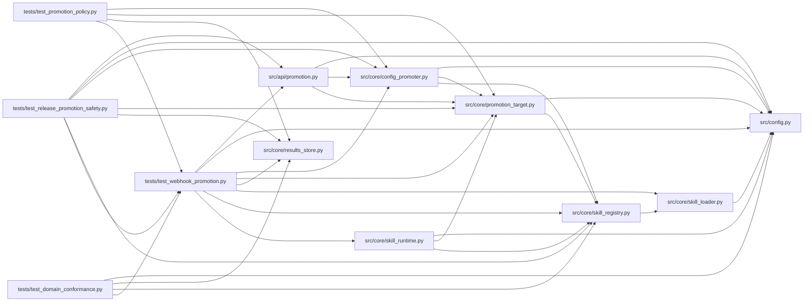

# test_webhook_promotion Module

**Path:** `tests/test_webhook_promotion.py`

## Description

Webhook promotion target tests (P1-3).

Covers: local provenance writes + endpoint delivery on the primary path only,
idempotency key + bearer auth, retry-then-fail-closed behavior, manifest
schema acceptance of ``kind: webhook``, runtime wiring for webhook and
registry_api kinds, and the API-layer per-session promoter selection.

ARC-012 P7-014 adds the non-ML promotion e2e through the single target
resolution site (``_promoter_for_session`` → ``promotion_target_from_manifest``):
a ``registry_api`` skill delivers to its declared endpoint (mock transport)
and records the durable ``target_descriptor``; a ``file_path`` skill writes
to its declared ``path_template``.

## Imports

| Source | Symbols |
|--------|---------|
| `__future__` | `annotations` |
| `httpx` | `httpx` |
| `json` | `json` |
| `os` | `os` |
| `pathlib` | `Path` |
| `pytest` | `pytest` |
| `src.api` | `promotion`, `promotion`, `promotion`, `promotion` |
| `src.config` | `settings`, `settings` |
| `src.core.config_promoter` | `ConfigPromoter` |
| `src.core.promotion_target` | `WebhookDeliveryError`, `WebhookPromotionTarget` |
| `src.core.results_store` | `ResultsStore`, `ResultsStore` |
| `src.core.skill_loader` | `load_skill_manifest` |
| `src.core.skill_registry` | `SkillRegistry`, `SkillRegistry` |
| `src.core.skill_runtime` | `ManifestSkillRuntime`, `SkillConfigError` |
| `types` | `SimpleNamespace`, `SimpleNamespace` |
| `typing` | `Any` |
| `unittest.mock` | `MagicMock` |
| `yaml` | `yaml` |

## Local dependency map

<!-- Auto-generated local dependency summary. Do not edit by hand. -->

### Internal neighbors

| Direction | Module |
|---|---|
| Inbound | [test_domain_conformance](../modules/test_domain_conformance.md) |
| Inbound | [test_promotion_policy](../modules/test_promotion_policy.md) |
| Inbound | [test_release_promotion_safety](../modules/test_release_promotion_safety.md) |
| Outbound | [promotion](../modules/promotion.md) |
| Outbound | [config](../modules/config.md) |
| Outbound | [config_promoter](../modules/config_promoter.md) |
| Outbound | [promotion_target](../modules/promotion_target.md) |
| Outbound | [results_store](../modules/results_store.md) |
| Outbound | [skill_loader](../modules/skill_loader.md) |
| Outbound | [skill_registry](../modules/skill_registry.md) |
| Outbound | [skill_runtime](../modules/skill_runtime.md) |

### External packages

| Language | Used packages | Undeclared packages |
|---|---:|---:|
| python | 3 | 1 |

## Functions

| Function | Signature | Decorators | Description |
|----------|-----------|------------|-------------|
| `_manifest` | `(skill_id: str)` | — | — |
| `_patch_mock_transport` | `(monkeypatch, handler) -> list[httpx.Request]` | — | Route httpx.AsyncClient through a MockTransport recording requests. |
| `_webhook_target` | `(tmp_path, **kwargs) -> WebhookPromotionTarget` | — | — |
| `_primary_path` | `(t: WebhookPromotionTarget) -> str` | — | — |
| `test_write_delivers_only_primary_path` | *(async)* `(monkeypatch, tmp_path)` | `@pytest.mark.asyncio` | — |
| `test_delivery_retries_then_fails_closed` | *(async)* `(monkeypatch, tmp_path)` | `@pytest.mark.asyncio` | — |
| `test_delivery_4xx_does_not_retry` | *(async)* `(monkeypatch, tmp_path)` | `@pytest.mark.asyncio` | — |
| `test_webhook_kind_accepted_by_manifest_schema` | `()` | — | — |
| `test_runtime_webhook_kind_builds_webhook_target` | `()` | — | — |
| `test_runtime_artifact_store_kind_still_raises_loudly` | `()` | — | — |
| `test_api_promoter_for_session_uses_webhook_target` | *(async)* `(monkeypatch)` | `@pytest.mark.asyncio` | — |
| `test_api_promoter_for_session_falls_back_without_endpoint` | *(async)* `(monkeypatch)` | `@pytest.mark.asyncio` | — |
| `_seed_completed_skill_session` | *(async)* `(store, tmp_path: Path, *, skill_id: str, metrics: dict) -> str` | — | Seed a completed non-ML session with a gates-passing best iteration |
| `test_registry_api_skill_confirm_delivers_and_records_descriptor` | *(async)* `(monkeypatch, tmp_path)` | `@pytest.mark.asyncio` | P7-014 AC: a ``registry_api`` skill (prompt-engineering) promotes |
| `test_file_path_skill_confirm_writes_declared_template` | *(async)* `(monkeypatch, tmp_path)` | `@pytest.mark.asyncio` | P7-014 AC: a ``file_path`` skill (code-refactor) promotes to its |
