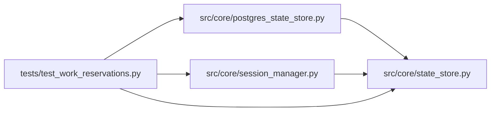

# test_work_reservations Module

**Path:** `tests/test_work_reservations.py`

## Description

Work reservations: atomic admission, ownership leases, and write fencing.

Covers the shared-storage admission contract: logical work plus global
capacity are reserved atomically before any side effect; ownership is leased
and fenced by a monotonic epoch; expired leases are reconciled without
touching live workers' sessions.

## Imports

| Source | Symbols |
|--------|---------|
| `__future__` | `annotations` |
| `asyncio` | `asyncio` |
| `json` | `json` |
| `os` | `os` |
| `pathlib` | `Path` |
| `pytest` | `pytest` |
| `src.core.postgres_state_store` | `build_state_store` |
| `src.core.session_manager` | `SessionManager` |
| `src.core.state_store` | `CapacityExceeded`, `SQLiteStateStore`, `StaleFenceError` |
| `subprocess` | `subprocess` |
| `sys` | `sys` |
| `textwrap` | `textwrap` |

## Local dependency map

<!-- Auto-generated local dependency summary. Do not edit by hand. -->

### Internal neighbors

| Direction | Module |
|---|---|
| Outbound | [postgres_state_store](../modules/postgres_state_store.md) |
| Outbound | [session_manager](../modules/session_manager.md) |
| Outbound | [state_store](../modules/state_store.md) |

### External packages

| Language | Used packages | Undeclared packages |
|---|---:|---:|
| python | 1 | 1 |

## Functions

| Function | Signature | Decorators | Description |
|----------|-----------|------------|-------------|
| `_open_store` | *(async)* `(tmp_path: Path) -> SQLiteStateStore` | — | — |
| `_make_session` | *(async)* `(store: SQLiteStateStore, session_id: str) -> dict` | — | — |
| `test_capacity_limit_and_duplicate_request_semantics` | *(async)* `(tmp_path)` | `@pytest.mark.asyncio` | — |
| `test_released_key_reserves_with_fresh_epoch` | *(async)* `(tmp_path)` | `@pytest.mark.asyncio` | — |
| `test_admission_race_with_real_separate_processes` | `(tmp_path)` | — | Real competing OS processes against one shared database. |
| `test_stale_owner_cannot_publish_evidence_or_promotion_effects` | *(async)* `(tmp_path)` | `@pytest.mark.asyncio` | — |
| `test_lease_expiry_reclaim_bumps_epoch_and_frees_capacity` | *(async)* `(tmp_path)` | `@pytest.mark.asyncio` | — |
| `test_live_lease_survives_reclaim_and_renews` | *(async)* `(tmp_path)` | `@pytest.mark.asyncio` | — |
| `test_orphan_classification_never_takes_a_live_workers_session` | *(async)* `(tmp_path)` | `@pytest.mark.asyncio` | — |
| `test_failed_start_releases_its_reservation` | *(async)* `(tmp_path, monkeypatch)` | `@pytest.mark.asyncio` | — |
| `_iter_reservations` | *(async)* `(store)` | — | — |
| `test_reservation_contract_on_postgres_store` | *(async)* `(tmp_path)` | `@pytest.mark.asyncio`, `@pytest.mark.skipif("not os.environ.get('AUTORESEARCH_DATABASE_URL')", reason='Postgres test legs require AUTORESEARCH_DATABASE_URL')` | The same admission and fencing contract holds on the shared store. |
