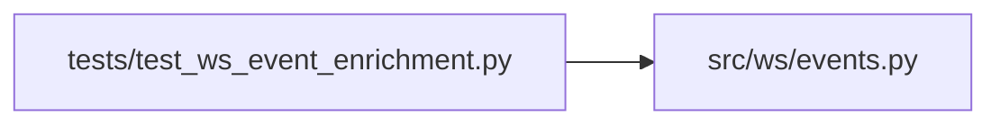

# test_ws_event_enrichment Module

**Path:** `tests/test_ws_event_enrichment.py`

## Description

P3-018 — WebSocket event payload enrichment tests (ARC-011 C-stream).

Validates that ``_enrich_event`` adds canonical ``skill_id``, ``skill_phase``,
``evidence_keys``, and ``metrics`` to WebSocket payloads additively (§10 #5:
event names unchanged; payloads only gain fields).

## Imports

| Source | Symbols |
|--------|---------|
| `__future__` | `annotations` |
| `os` | `os` |
| `src.ws.events` | `_enrich_event` |

## Local dependency map

<!-- Auto-generated local dependency summary. Do not edit by hand. -->

### Internal neighbors

| Direction | Module |
|---|---|
| Outbound | [events](../modules/events.md) |

## Functions

| Function | Signature | Decorators | Description |
|----------|-----------|------------|-------------|
| `test_enrich_adds_skill_id_from_model_type` | `()` | — | — |
| `test_enrich_preserves_existing_skill_id` | `()` | — | — |
| `test_enrich_adds_skill_phase_from_search_phase` | `()` | — | — |
| `test_enrich_skill_phase_absent_when_no_search_phase` | `()` | — | — |
| `test_enrich_adds_evidence_keys_from_phase_evidence` | `()` | — | — |
| `test_enrich_evidence_keys_absent_when_no_phase_evidence` | `()` | — | — |
| `test_enrich_adds_metrics_summary` | `()` | — | — |
| `test_enrich_does_not_remove_existing_fields` | `()` | — | — |
| `test_enrich_non_dict_returns_unchanged` | `()` | — | — |
