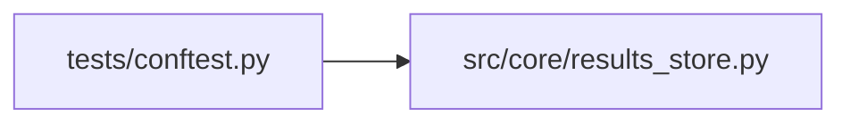

# conftest Module

**Path:** `tests/conftest.py`

## Description

_Auto-generated from `tests/conftest.py`._

## Imports

| Source | Symbols |
|--------|---------|
| `__future__` | `annotations` |
| `json` | `json` |
| `os` | `os` |
| `pathlib` | `Path` |
| `pytest` | `pytest` |
| `src.core.results_store` | `ResultsStore` |
| `sys` | `sys` |
| `typing` | `Any`, `Dict`, `List`, `NamedTuple` |

## Local dependency map

<!-- Auto-generated local dependency summary. Do not edit by hand. -->

### Internal neighbors

| Direction | Module |
|---|---|
| Outbound | [results_store](../modules/results_store.md) |

### External packages

| Language | Used packages | Undeclared packages |
|---|---:|---:|
| python | 1 | 1 |

## Classes

| Class | Line | Bases | Description |
|-------|------|-------|-------------|
| [ReplayContext](../entities/ReplayContext.md) | 88 | `NamedTuple` | Result of seeding a ResultsStore from a JSON fixture file. |

## Functions

| Function | Signature | Decorators | Description |
|----------|-----------|------------|-------------|
| `close_initialized_results_stores` | *(async)* `(monkeypatch: pytest.MonkeyPatch, request: pytest.FixtureRequest)` | `@pytest.fixture(autouse=True)` | Close long-lived SQLite connections created by tests. |
| `_phase6_postgres_dsn` | `() -> str \| None` | — | — |
| `pytest_collection_modifyitems` | `(config: pytest.Config, items: list[pytest.Item]) -> None` | — | Skip ``@pytest.mark.postgres`` / ``distributed`` tests when no Postgres DSN. |
| `replay_iterations` | `(tmp_path: Path)` | `@pytest.fixture` | Factory fixture: seed a ResultsStore from a JSON fixture file. |
