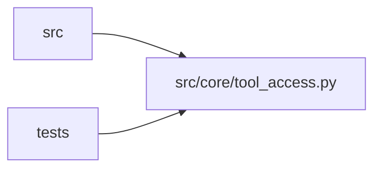

# tool_access Module

**Path:** `src/core/tool_access.py`

## Description

Shared file-tool authorization: one context for every file operation.

Every path a tool call exposes — read, write, glob, grep, copy, and any
path-bearing tool argument — resolves through the same authorization
context. The context is derived server-side from run/attempt ownership
(the run's session workspace) plus skill declarations; tool-supplied paths,
candidate files, and workspace instructions never grant additional access.

Authorization model:

* ``readable_roots`` / ``writable_roots`` are explicit roots. A resolved
  path outside every root of the requested kind is rejected — sibling
  sessions, evaluator packages, interpreter environments, control-plane
  storage, and shared evaluation assets are excluded by construction
  because they live outside the owning session's workspace.
* ``protected_paths`` / ``protected_names`` carve server-owned state out of
  the writable roots: private evidence, command logs, trial staging, the
  bootstrap and session manifests, and skill-declared evaluation data are
  never candidate-writable even though they live inside the workspace.
* Relative tool paths resolve against the session workspace; the legacy
  shared-root path style is still accepted when it lands inside the
  authorized roots. Absolute paths are accepted only when they land inside
  an authorized root.

The shared workspace root is carried for command-policy plumbing (the
governed interpreter and legacy ``cd`` normalization live there); it is
never an authorization root for file access.

## Imports

| Source | Symbols |
|--------|---------|
| `__future__` | `annotations` |
| `dataclasses` | `dataclass`, `field` |
| `fnmatch` | `fnmatch` |
| `os` | `os` |
| `pathlib` | `Path` |
| `stat` | `stat` |
| `typing` | `Iterable`, `Optional`, `Sequence` |

## Local dependency map

<!-- Auto-generated local dependency summary. Do not edit by hand. -->

> Module-level dependencies exceed the generated-diagram limits, so the diagram and table below group them by top-level package. Counts report the number of module neighbors in each package.

### Internal neighbors

| Direction | Module |
|---|---|
| Inbound | `src` (3) |
| Inbound | `tests` (9) |

> All 12 module neighbor(s) are summarized by package because the module-level view exceeds the 12-node limit.

## Classes

| Class | Line | Bases | Description |
|-------|------|-------|-------------|
| [ToolAccessContext](../entities/ToolAccessContext.md) | 107 | — | Server-derived file authorization for one run/attempt's tool calls. |

## Functions

| Function | Signature | Decorators | Description |
|----------|-----------|------------|-------------|
| `_resolved` | `(path: str \| os.PathLike[str]) -> str` | — | — |
| `path_within_roots` | `(path: str, roots: Sequence[str], *, follow_leaf: bool = True) -> bool` | — | Whether ``path`` resolves inside one of ``roots``. |
| `matches_protected_name` | `(relative: str, patterns: Sequence[str]) -> bool` | — | Whether a workspace-relative path matches a protected name/pattern. |
| `_multi_link_reason` | `(path: str) -> Optional[str]` | — | Reason a leaf is an ambiguous shared-file alias, or ``None``. |
| `build_tool_access_context` | `(session_workspace: str, *, workspace_root: Optional[str] = None, extra_protected_names: Optional[Iterable[str]] = None) -> ToolAccessContext` | — | Derive the file authorization for one run/attempt, server-side. |
