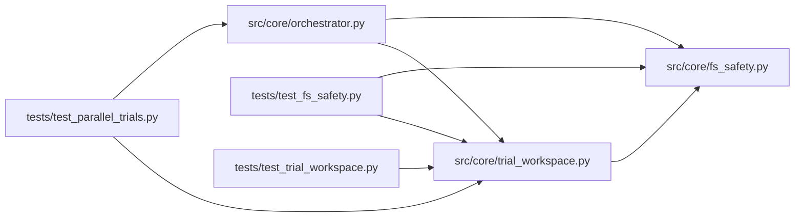

# trial_workspace Module

**Path:** `src/core/trial_workspace.py`

## Description

Per-workdir trial state (P2 — the ``execution.concurrency`` prerequisite).

Every per-command piece of orchestrator state that today derives from the
*session* workspace — the pre-run config snapshot, the governed subprocess
cwd, the marker/results fallback files, and the runtime-command provenance —
is derived from a :class:`TrialContext` instead. With
``execution.concurrency == 1`` (the default) the context's ``trial_dir`` is
``None`` and every call site resolves against the session workspace exactly
as before (byte-identical behavior). A skill that opts into
``execution.concurrency > 1`` gets each sanctioned experiment command
executed inside its own isolated trial directory: a staged copy of the
session workspace at dispatch time, so concurrent trials can never clobber
each other's candidate configs, marker files, or result artifacts.

Trial eligibility reuses the sanctioned-scripts rule already governing the
W11 nonce delivery (``_nonce_env_for_command``) and the
``turn_ran_training_command`` flag: a bash command is trial-eligible iff it
invokes one of the skill manifest's declared ``allowed_scripts``. Bookkeeping
commands (``cp``/``cat``) and non-bash tools keep running against the session
workspace.

Trial directories live under ``<session_workspace>/.trials/`` — inside the
session workspace, so every existing path-safety and command-policy check
applies unchanged — and are retained as operator-inspectable provenance.

## Imports

| Source | Symbols |
|--------|---------|
| `__future__` | `annotations` |
| `dataclasses` | `dataclass` |
| `logging` | `logging` |
| `pathlib` | `Path` |
| `src.core` | `fs_safety` |
| `typing` | `Iterable`, `Mapping`, `Optional` |

## Local dependency map

<!-- Auto-generated local dependency summary. Do not edit by hand. -->

### Internal neighbors

| Direction | Module |
|---|---|
| Inbound | [orchestrator](../modules/orchestrator.md) |
| Inbound | [test_fs_safety](../modules/test_fs_safety.md) |
| Inbound | [test_parallel_trials](../modules/test_parallel_trials.md) |
| Inbound | [test_trial_workspace](../modules/test_trial_workspace.md) |
| Outbound | [fs_safety](../modules/fs_safety.md) |

## Classes

| Class | Line | Bases | Description |
|-------|------|-------|-------------|
| [TrialContext](../entities/TrialContext.md) | 52 | — | Per-command execution context (P2 per-workdir state). |

## Functions

| Function | Signature | Decorators | Description |
|----------|-----------|------------|-------------|
| `is_trial_eligible_command` | `(command: object, allowed_scripts: Optional[Iterable[str] \| Mapping[str, str]]) -> bool` | — | True when a bash command invokes one of the skill's sanctioned scripts. |
| `allocate_trial_dir` | `(session_workspace: str, *, turn: int, seq: int) -> str` | — | Create (idempotently) and return this command's trial directory. |
| `stage_trial_workspace` | `(session_workspace: str, trial_dir: str) -> int` | — | Copy the session-workspace state into the trial directory. |
| `stage_trial_or_none` | `(session_workspace: str, trial_dir: str) -> Optional[str]` | — | Stage a trial workspace, returning ``trial_dir`` or ``None`` on failure. |
| `trial_marker_candidates` | `(trial_dir: str, marker_paths: Iterable[Path]) -> list[Path]` | — | Trial-dir-first candidates for the marker-file fallback. |
| `build_trial_context` | `(*, research_id: str, turn: int, seq: int, session_workspace: str, command: object, allowed_scripts: Optional[Iterable[str] \| Mapping[str, str]], execution_concurrency: int) -> TrialContext` | — | Build the per-command context, allocating a trial dir when eligible. |
