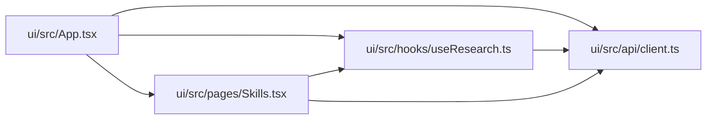

# Skills Module

**Path:** `ui/src/pages/Skills.tsx`

## Description

_Auto-generated from `ui/src/pages/Skills.tsx`._

## Imports

| Source | Symbols |
|--------|---------|
| `../api/client` | `api`, `GeneratedSkillDraft` |
| `../hooks/useResearch` | `useSkills` |
| `@tanstack/react-query` | `useMutation`, `useQueryClient` |
| `react` | `FormEvent`, `useState` |

## Module Signals

| Signal | Values |
|--------|--------|
| Exports | `default` |

## Local dependency map

<!-- Auto-generated local dependency summary. Do not edit by hand. -->

### Internal neighbors

| Direction | Module |
|---|---|
| Inbound | [App](../modules/App.md) |
| Outbound | [client](../modules/client.md) |
| Outbound | [useResearch](../modules/useResearch.md) |

### External packages

| Language | Used packages | Undeclared packages |
|---|---:|---:|
| typescript | 2 | 0 |

## Functions

| Function | Signature | Decorators | Description |
|----------|-----------|------------|-------------|
| `Skills` | `()` | — | — |
