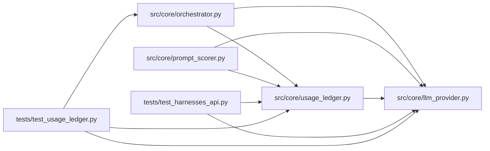

# usage_ledger Module

**Path:** `src/core/usage_ledger.py`

## Description

Append-only, idempotent usage ledger with explicit cost knowledge.

One usage event per logical provider call (agent, insight, or evaluator
role), keyed for idempotency so retries and replayed events never
double-charge. Money knowledge is explicit: reported usage, estimated money,
billed money, and unavailable cost are distinct — an unavailable cost is
never displayed as zero. Each event snapshots the versioned pricing basis it
used, so later price changes cannot silently rewrite history.

## Imports

| Source | Symbols |
|--------|---------|
| `__future__` | `annotations` |
| `dataclasses` | `asdict`, `dataclass`, `field` |
| `datetime` | `datetime`, `timezone` |
| `src.core.llm_provider` | `COST_BILLED`, `COST_ESTIMATED`, `COST_UNAVAILABLE`, `CostEstimate`, `Usage` |
| `typing` | `Any`, `Dict`, `List`, `Mapping`, `Optional` |

## Local dependency map

<!-- Auto-generated local dependency summary. Do not edit by hand. -->

### Internal neighbors

| Direction | Module |
|---|---|
| Inbound | [orchestrator](../modules/orchestrator.md) |
| Inbound | [prompt_scorer](../modules/prompt_scorer.md) |
| Inbound | [test_harnesses_api](../modules/test_harnesses_api.md) |
| Inbound | [test_usage_ledger](../modules/test_usage_ledger.md) |
| Outbound | [llm_provider](../modules/llm_provider.md) |

## Classes

| Class | Line | Bases | Description |
|-------|------|-------|-------------|
| [UsageEvent](../entities/UsageEvent.md) | 32 | — | One metered provider call with its cost knowledge. |

## Functions

| Function | Signature | Decorators | Description |
|----------|-----------|------------|-------------|
| `event_from_quote` | `(*, event_key: str, research_id: str, role: str, provider: str, model: str, usage: Usage, quote: CostEstimate, iteration: Optional[int] = None, turn: Optional[int] = None) -> UsageEvent` | — | Build an event from a provider's price quote. |
| `mark_billed` | `(event: UsageEvent, billed_usd: float) -> UsageEvent` | — | The billed outcome for an event (actual money, replacing estimates). |
| `record_usage_event` | *(async)* `(store: Any, event: UsageEvent) -> bool` | — | Append one event; returns False when the key was already recorded. |
| `summarize_usage` | `(events: List[Mapping[str, Any]]) -> Dict[str, Any]` | — | Aggregate one session's events without conflating cost knowledge. |
