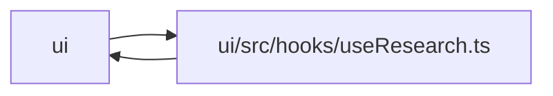

# useResearch Module

**Path:** `ui/src/hooks/useResearch.ts`

## Description

_Auto-generated from `ui/src/hooks/useResearch.ts`._

## Imports

| Source | Symbols |
|--------|---------|
| `../api/client` | `api`, `PromotionPreviewRequest`, `PromotionScopeRequest`, `StartResearchRequest`, `PaginatedResponse`, `ResearchSession` |
| `./useWebSocket` | `useWebSocket` |
| `@tanstack/react-query` | `useQuery`, `useMutation`, `useQueryClient` |
| `react` | `useEffect` |

## Module Signals

| Signal | Values |
|--------|--------|
| Exports | `ResearchRealtimeBridge`, `useAgentLog`, `useBestIteration`, `useConfirmPromotion`, `useContinueSession`, `useCostEstimate`, `useDeleteSession`, `useIterations`, `useModels`, `usePauseSession`, `usePreviewPromotion`, `usePromotions`, `useResearchState`, `useResults`, `useResumeSession`, `useSession`, `useSessions`, `useSessionsPage`, `useSkillFormFields`, `useSkillLeaderboard`, `useSkillMetricSchema`, `useSkills`, `useStartResearch`, `useStatus`, `useStopSession` |

## Local dependency map

<!-- Auto-generated local dependency summary. Do not edit by hand. -->

> Module-level dependencies exceed the generated-diagram limits, so the diagram and table below group them by top-level package. Counts report the number of module neighbors in each package.

### Internal neighbors

| Direction | Module |
|---|---|
| Inbound | `ui` (11) |
| Outbound | `ui` (2) |

### External packages

| Language | Used packages | Undeclared packages |
|---|---:|---:|
| typescript | 2 | 0 |

> All 13 module neighbor(s) are summarized by package because the module-level view exceeds the 12-node limit.

## Functions

| Function | Signature | Decorators | Description |
|----------|-----------|------------|-------------|
| `ResearchRealtimeBridge` | `()` | — | — |
| `useSessions` | `()` | — | — |
| `useSessionsPage` | `(limit: number, offset: number)` | — | — |
| `useSession` | `(id: string)` | — | — |
| `useResults` | `(id: string)` | — | — |
| `useIterations` | `(id: string)` | — | — |
| `useResearchState` | `(id: string)` | — | — |
| `useBestIteration` | `(id: string)` | — | — |
| `useAgentLog` | `(id: string, isActive = false)` | — | — |
| `useModels` | `()` | — | — |
| `useSkills` | `()` | — | — |
| `useSkillFormFields` | `(skillId: string \| null)` | — | — |
| `useSkillMetricSchema` | `(skillId: string \| null)` | — | — |
| `useSkillLeaderboard` | `(skillId: string \| null, limit = 20)` | — | — |
| `useStatus` | `()` | — | — |
| `usePromotions` | `()` | — | — |
| `useStartResearch` | `()` | — | — |
| `useCostEstimate` | `(maxIterations: number, quickMode: boolean, maxBudgetUsd: number)` | — | — |
| `useStopSession` | `()` | — | — |
| `usePauseSession` | `()` | — | — |
| `useResumeSession` | `()` | — | — |
| `useContinueSession` | `()` | — | — |
| `useDeleteSession` | `()` | — | — |
| `usePreviewPromotion` | `()` | — | — |
| `useConfirmPromotion` | `()` | — | — |
