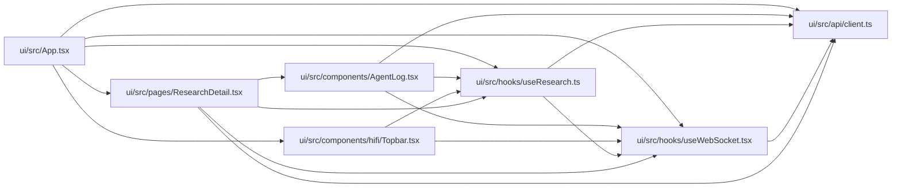

# useWebSocket Module

**Path:** `ui/src/hooks/useWebSocket.tsx`

## Description

_Auto-generated from `ui/src/hooks/useWebSocket.tsx`._

## Imports

| Source | Symbols |
|--------|---------|
| `../api/client` | `getAutoresearchWebSocketProtocols` |
| `react` | `createContext`, `ReactNode`, `useCallback`, `useContext`, `useEffect`, `useRef`, `useState` |

## Module Signals

| Signal | Values |
|--------|--------|
| Exports | `WSEvent`, `WebSocketProvider`, `useWebSocket` |
| Constants | `WebSocketContext` |
| Module calls | `WebSocketContext = createContext` |

## Local dependency map

<!-- Auto-generated local dependency summary. Do not edit by hand. -->

### Internal neighbors

| Direction | Module |
|---|---|
| Inbound | [App](../modules/App.md) |
| Inbound | [AgentLog](../modules/AgentLog.md) |
| Inbound | [Topbar](../modules/Topbar.md) |
| Inbound | [useResearch](../modules/useResearch.md) |
| Inbound | [ResearchDetail](../modules/ResearchDetail.md) |
| Outbound | [client](../modules/client.md) |

### External packages

| Language | Used packages | Undeclared packages |
|---|---:|---:|
| typescript | 1 | 0 |

## Classes

| Class | Kind | Line | Bases / Target | Description |
|-------|------|------|----------------|-------------|
| [WSEvent](../entities/WSEvent.md) | Class | 12 | — | — |
| [WebSocketContextValue](../entities/WebSocketContextValue.md) | Class | 20 | — | — |

## Functions

| Function | Signature | Decorators | Description |
|----------|-----------|------------|-------------|
| `WebSocketProvider` | `({ children }: { children: ReactNode })` | — | — |
| `useWebSocket` | `()` | — | — |
